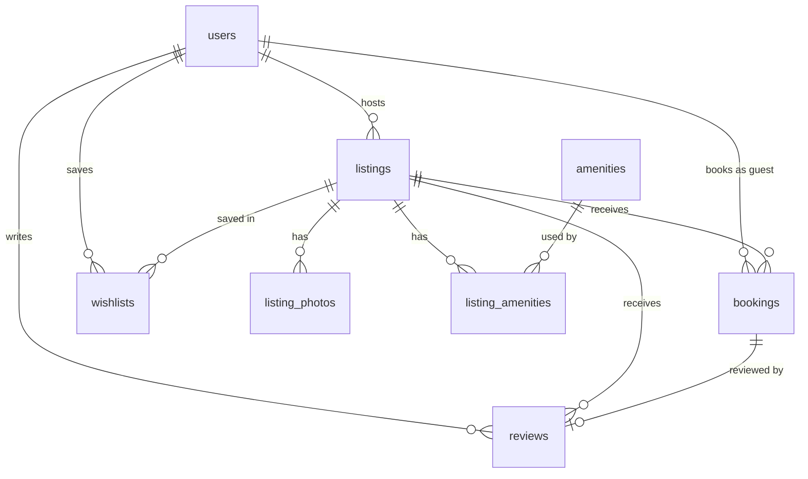

# Roost

A full-stack clone of the Airbnb web app with an original name and logo. Guests browse, search, filter,
save and book stays. Hosts create and manage listings and see their reservations.

**Live demo:** _add link after deploy_

## Tech stack

| Layer    | Choice                                                    |
| -------- | --------------------------------------------------------- |
| Frontend | Next.js 16 (App Router), React 19, TypeScript, Tailwind 4 |
| Backend  | Python, FastAPI, SQLAlchemy 2, Pydantic 2                 |
| Database | SQLite                                                    |

## Setup

Backend (port 8000). The database is created and seeded on first start.

```bash
cd backend
python -m venv .venv && .venv/bin/pip install -r requirements.txt
.venv/bin/uvicorn app.main:app --reload
```

Frontend (port 3000):

```bash
cd frontend
pnpm install
pnpm dev
```

Open http://localhost:3000. API docs (Swagger): http://localhost:8000/docs.

- Reset the data: delete `backend/roost.db` and restart the backend.
- Check the booking rules: `cd backend && .venv/bin/python test_bookings.py`.

### Demo accounts

There is no password login. The account menu (top right) has a **Switch account** list with the seeded
users: 6 hosts and 4 guests. The first visit logs in as the guest Maya Okafor, who has an upcoming trip,
a completed stay to review, and a wishlist. A guest can click **Become a host** to get host rights.

## Architecture

```
frontend/                      Next.js (all data comes from the API in the browser)
  app/                         routes
    page.tsx                   explore grid: search, categories, filters, infinite scroll
    listings/[id]/page.tsx     listing detail: gallery, calendar, booking card, reviews, map
    book/[id]/page.tsx         checkout (mock payment) and confirmation
    trips/  wishlists/         guest pages
    host/                      host dashboard, create and edit listing
  components/                  reusable UI: Calendar, ListingCard, SearchBar, Modal, BookingCard...
  lib/
    api.ts                     fetch wrapper (adds the mock-auth header), formatters
    session.tsx                current user + wishlist (React context)
    toast.tsx                  toast notifications (React context)
    hooks.ts                   useFetch, useDismiss
    dates.ts  types.ts  constants.ts

backend/app/
  main.py                      app, CORS, routers, startup (create tables + seed)
  database.py                  engine, session, get_db dependency
  models.py                    SQLAlchemy tables
  schemas.py                   Pydantic request/response models
  deps.py                      current_user / require_host (the mock auth lives here)
  booking_rules.py             date-overlap condition and price quote
  routers/                     listings.py, bookings.py, users.py
  seed.py                      demo data
```

Main ideas:

- **The URL is the search state.** Location, dates, guests, category and filters are query parameters of
  `/`. The explore page reads them and calls `GET /api/listings` with the same parameters. Searches can
  be shared and the back button works.
- **One rule for availability.** `booking_rules.overlaps()` is the only place that says when two stays
  collide (`existing.check_in < new.check_out AND existing.check_out > new.check_in`, confirmed bookings
  only). Search, booking creation and the delete guard all use it. Check-out is exclusive, so a guest can
  arrive on the day another guest leaves.
- **One rule for price.** `booking_rules.make_quote()` computes nights × price + cleaning fee + 14% service
  fee. The booking card, the checkout page and the saved booking all use it; the frontend never calculates money.
- **The server is the authority.** The calendar blocks booked dates for a good experience, but
  `POST /api/bookings` checks again and answers `409` if the dates were taken in the meantime.
- **Dates are `YYYY-MM-DD` strings** from the calendar to the database, so no time-zone conversion can shift a day.

## Database schema



| Table               | Columns                                                                                                                                                              | Notes                                                                       |
| ------------------- | -------------------------------------------------------------------------------------------------------------------------------------------------------------------- | --------------------------------------------------------------------------- |
| `users`             | id, name, email (unique), avatar_url, bio, is_host, is_superhost, created_at                                                                                         | `is_host` is the guest/host distinction                                     |
| `listings`          | id, host_id → users, title, description, property_type, category, city, country, lat, lng, price_per_night, cleaning_fee, max_guests, bedrooms, beds, baths, created_at, is_deleted | CHECK price > 0, max_guests > 0; indexes on host_id, category, city         |
| `listing_photos`    | id, listing_id → listings, url, position                                                                                                                             | ordered gallery; deleted with the listing                                   |
| `amenities`         | id, name (unique), icon                                                                                                                                              | lookup table                                                                |
| `listing_amenities` | listing_id → listings, amenity_id → amenities                                                                                                                        | many-to-many, composite primary key                                         |
| `bookings`          | id, listing_id → listings, guest_id → users, check_in, check_out, guests, nightly_price, cleaning_fee, service_fee, total, status, created_at                        | CHECK check_out > check_in; index (listing_id, check_in, check_out)         |
| `reviews`           | id, listing_id → listings, author_id → users, booking_id → bookings (unique, nullable), rating, comment, created_at                                                  | CHECK rating 1–5; unique booking_id = one review per stay                   |
| `wishlists`         | user_id → users, listing_id → listings, created_at                                                                                                                   | composite primary key = a listing is saved once per user                    |

Design decisions:

- A booking stores a **price snapshot**. If the host changes the price later, old bookings keep their total.
- A listing's **rating and review count are SQL subqueries** (`column_property` in `models.py`), not stored
  columns, so they are always correct.
- Deleting a listing is a **soft delete** (`listings.is_deleted`): it disappears from search and the host
  dashboard, but guests keep their past trips and reviews.
- Cancelling sets `status = 'cancelled'` and keeps the row; the dates become free because the overlap rule
  ignores cancelled bookings.
- Foreign keys are enforced (`PRAGMA foreign_keys=ON`).

## API overview

All routes are under `/api`. Routes marked 🔒 need the `X-User-Id` header; 🏠 also need a host account.

| Method | Path                                | Purpose                                                                                                                                        |
| ------ | ----------------------------------- | ---------------------------------------------------------------------------------------------------------------------------------------------- |
| GET    | `/listings`                         | Search. Query: `location, check_in, check_out, guests, category, min_price, max_price, bedrooms, property_type*, amenities*, page, page_size` |
| GET    | `/listings/{id}`                    | Listing detail with host, amenities, reviews                                                                                                   |
| GET    | `/listings/{id}/availability`       | Booked date ranges (for the calendar)                                                                                                          |
| GET    | `/listings/{id}/quote`              | Price breakdown for `check_in`, `check_out`                                                                                                    |
| GET    | `/amenities`                        | Amenity list for filters and the host form                                                                                                     |
| POST   | `/listings` 🏠                      | Create a listing                                                                                                                               |
| PUT    | `/listings/{id}` 🏠                 | Update own listing                                                                                                                             |
| DELETE | `/listings/{id}` 🏠                 | Soft-delete own listing (`409` if it has upcoming bookings)                                                                                    |
| POST   | `/uploads` 🏠                       | Upload a photo (image, max 5 MB); returns its URL                                                                                              |
| GET    | `/host/listings` 🏠                 | Own listings                                                                                                                                   |
| GET    | `/host/bookings` 🏠                 | Reservations on own listings                                                                                                                   |
| POST   | `/bookings` 🔒                      | Book a stay (`409` if the dates overlap or the price changed)                                                                                  |
| GET    | `/bookings/mine` 🔒                 | My trips                                                                                                                                       |
| POST   | `/bookings/{id}/cancel` 🔒          | Cancel (guest or host, before check-in)                                                                                                        |
| POST   | `/bookings/{id}/review` 🔒          | Review a completed stay (once)                                                                                                                 |
| GET    | `/users`, `/users/me` 🔒            | Demo accounts, current user                                                                                                                    |
| POST   | `/users/me/become-host` 🔒          | Turn a guest account into a host account                                                                                                       |
| GET    | `/wishlist` 🔒                      | Saved listings                                                                                                                                 |
| PUT / DELETE | `/wishlist/{listing_id}` 🔒   | Save / remove a listing                                                                                                                        |

## Feature checklist

- Explore grid, search bar (location, dates, guests), category row, filters modal, infinite scroll
- Listing page: photo gallery with modal, amenities, host, availability calendar, price breakdown, reviews, map
- Booking: date and guest validation, no overlapping stays, mock checkout, confirmation, My Trips, cancel
- Host: dashboard with stats, create / edit / delete listings, photo by URL or upload, reservations
- Wishlist, toasts, modals, responsive layout
- Bonus: review after a completed stay, Superhost badges, rating aggregation

## Assumptions and simplifications

- **Auth is mocked.** The frontend sends the chosen account id in an `X-User-Id` header. All auth logic is
  in `backend/app/deps.py`, so real sessions or JWT replace one function.
- **Payment is mocked.** The checkout shows a disabled card form; confirming creates the booking.
- **Messaging** shows a "coming soon" toast.
- **Map** is a static OpenStreetMap embed with one marker. Listings made in the host form have no coordinates and show no map.
- **Seed photos** come from Unsplash (fetched once via its search API, list in `backend/app/seed_photos.json`). The running app needs no API key.
- **Uploads** are stored on the API server's disk (`UPLOAD_DIR`), on the same volume as the database in production.
- **Prices** are whole US dollars. Service fee is 14% of the nightly subtotal.
- **Concurrency:** the availability check and the insert run inside one process-wide lock, so two requests
  for the same dates cannot both succeed (tested with 8 parallel requests). This is correct for one server
  process. With several processes or PostgreSQL, an exclusion constraint on the date range is the correct tool.
- **"Today" is the server's date.** A browser in a different time zone can show one day as free that the
  server refuses as past.
- **Uploads** are checked for size, declared type and file extension, not for real image content.
- Schema changes need a database reset (no migration tool).

## Deploy

**Backend — Railway** (needs a persistent volume, so bookings and uploads survive restarts):

1. New project → Deploy from GitHub repo → this repo. Root directory: `backend`.
2. Start command: `uvicorn app.main:app --host 0.0.0.0 --port $PORT`.
3. Add a volume mounted at `/data`.
4. Variables: `DATABASE_URL=sqlite:////data/roost.db`, `UPLOAD_DIR=/data/uploads`.
5. Generate a domain and check `https://<domain>/api/health`.

The database is created and seeded on the first start, then kept on the volume.

**Frontend — Vercel:** root directory `frontend`, variable `NEXT_PUBLIC_API_URL=https://<backend-domain>`.

Environment variables:

| Name | Where | Default |
| --- | --- | --- |
| `DATABASE_URL` | backend | `sqlite:///./roost.db` |
| `UPLOAD_DIR` | backend | `uploads` |
| `NEXT_PUBLIC_API_URL` | frontend | `http://localhost:8000` |
